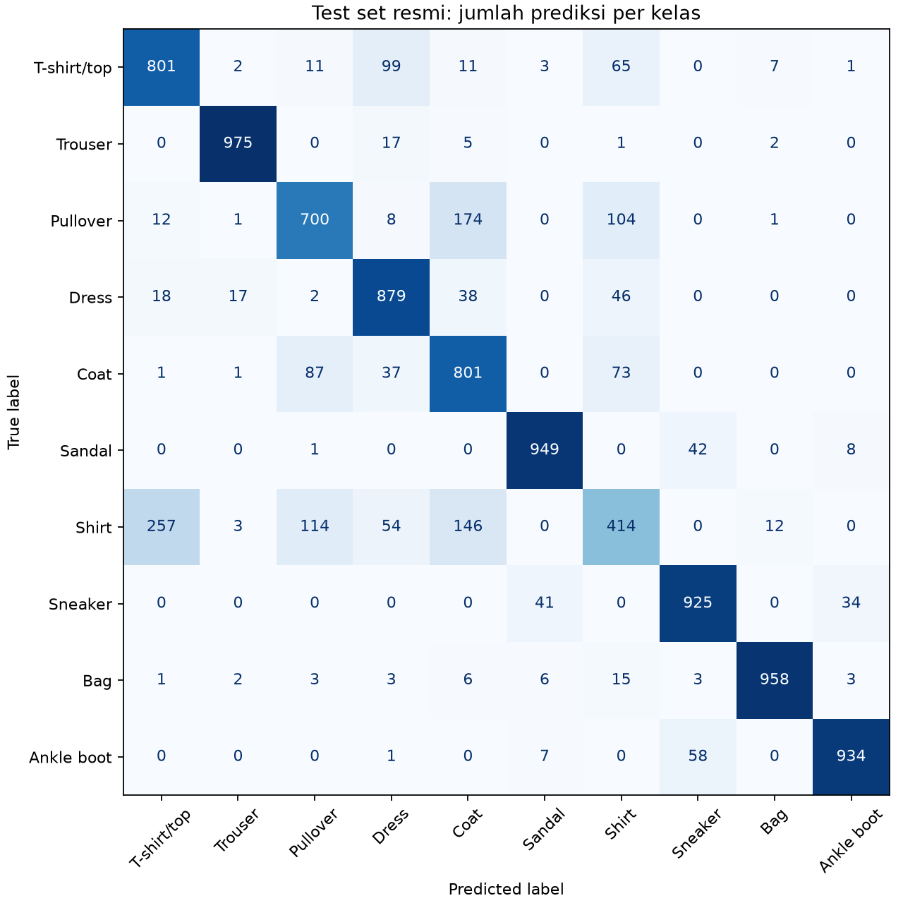
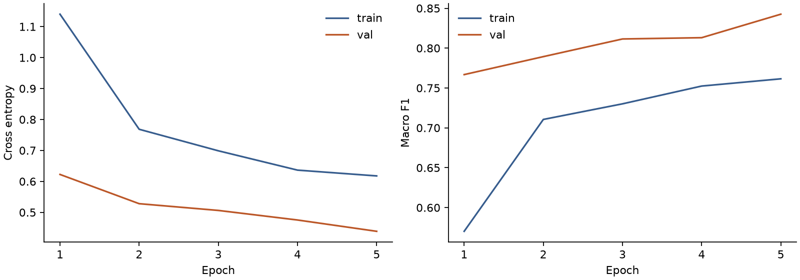
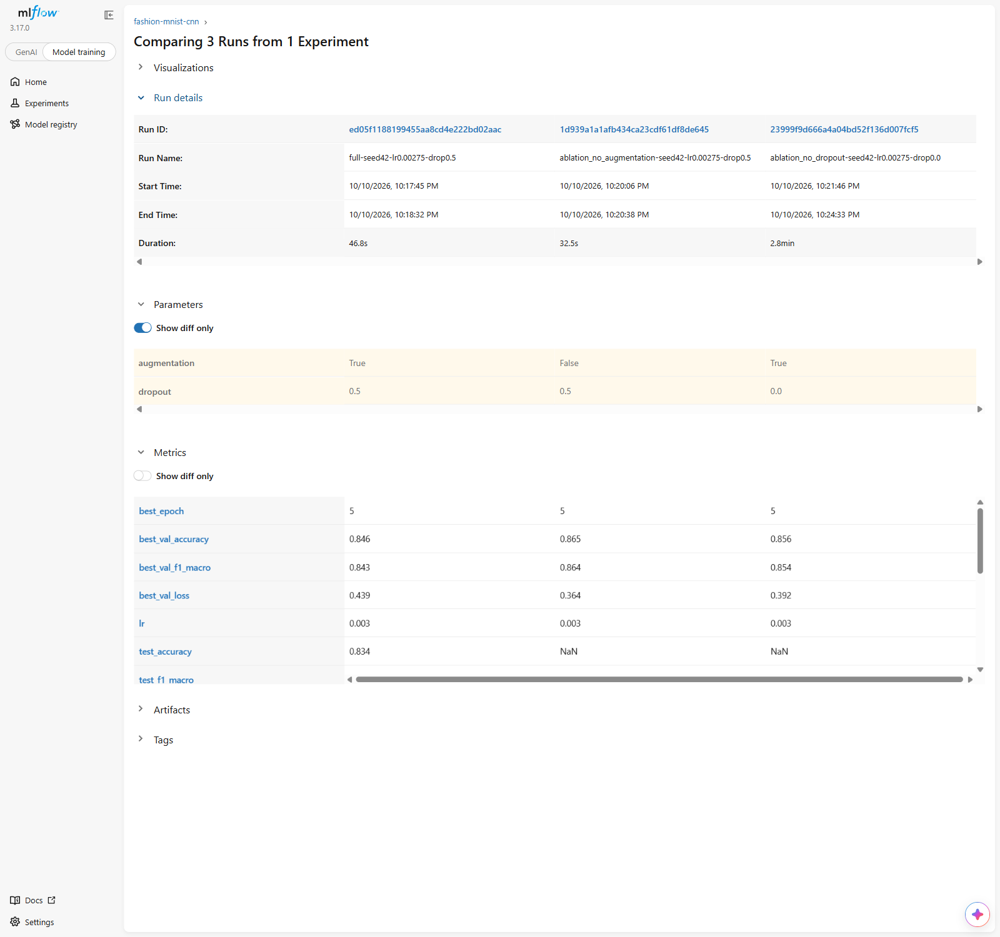
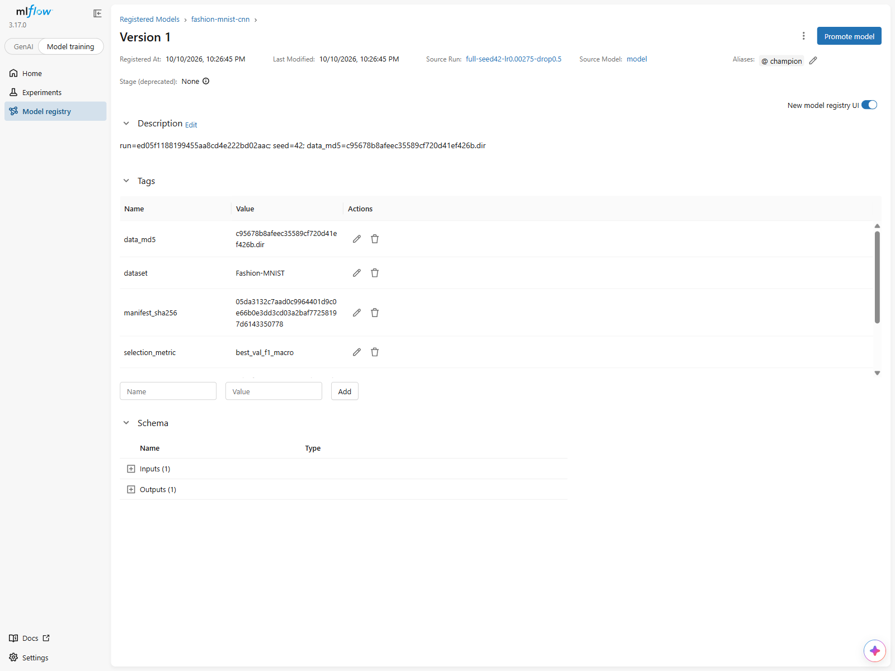
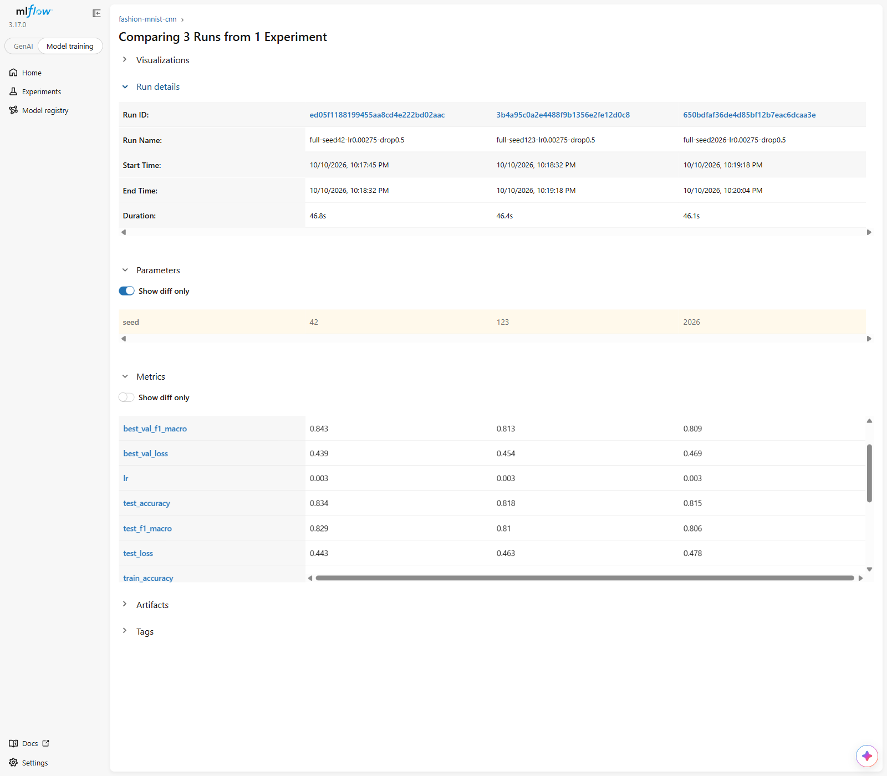
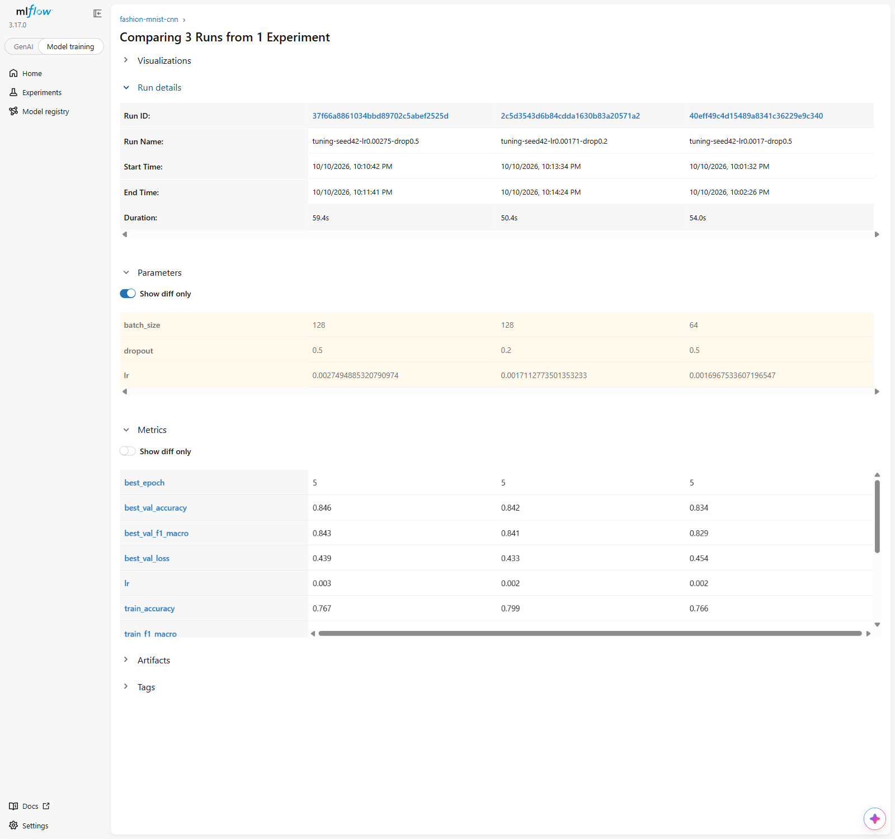

# Laporan Praktikum MLOps: CNN Fashion-MNIST

Praktikum berdasarkan tugas pada slide 88 [materi perkuliahan](slide_presentation.pdf). Eksperimen selesai: 30 training run, 20 trial Optuna, tiga seed, dua ablation, dan model registry dengan alias `champion`.

Panduan instalasi dan menjalankan ulang eksperimen tersedia di [panduan proyek](docs/panduan.md). Hasil per run tersedia di [run_results.csv](reports/run_results.csv).

## Pertanyaan dan hipotesis

Apakah tuning hyperparameter memperbaiki macro F1 CNN Fashion-MNIST dibanding baseline? Apakah augmentasi ringan dan dropout membantu generalisasi pada split yang tetap?

Hipotesis awal: konfigurasi hasil tuning meningkatkan rata-rata validation macro F1 terhadap baseline; augmentasi meningkatkan F1 terhadap kondisi tanpa augmentasi; dropout meningkatkan F1 terhadap kondisi tanpa dropout. Pengujian memakai split tetap dan pasangan seed yang sama untuk ablation.

## Metode

Rancangan memakai subset stratified Fashion-MNIST: 12,000 train dan 3,000 validation dari training resmi, dengan split seed 42. Test set resmi hanya dibuka setelah seleksi dikunci. Normalisasi dihitung pada train saja.

CNN terdiri dari convolution 16 dan 32 channel, max pooling, serta classifier 64 unit. Optimizer Adam; setiap training mendapat 5 epoch di CPU. Checkpoint dipilih dari validation macro F1 tertinggi; jika seri, epoch lebih awal dipertahankan. Accuracy dan loss menjadi metrik tambahan.

Optuna memakai TPE, sampler seed 42, learning rate log-uniform 0.0001 sampai 0.003, batch size [64, 128], dan dropout [0.2, 0.35, 0.5]. Targetnya 20 trial selesai tanpa pruning, dijalankan berurutan sebagai nested runs MLflow.

Konfigurasi terbaik dilatih ulang dengan seed [42, 123, 2026]. Kedua ablation memakai seed yang sama tanpa tuning ulang. Std yang dilaporkan adalah sample standard deviation (ddof=1).

## Bukti pelaksanaan

| Kelompok | Run selesai |
|---|---:|
| baseline | 1 |
| tuning | 20 |
| full | 3 |
| ablation_no_augmentation | 3 |
| ablation_no_dropout | 3 |

Hash dataset DVC: `c95678b8afeec35589cf720d41ef426b.dir`.

SHA-256 indeks split: `d10782b84d0544a9a4bc7129d613aa075f226843d89b4dac0408399e4c9a724c`.

## Hasil validation

| Kelompok | n | Macro F1 | Accuracy |
|---|---:|---:|---:|
| Baseline | 1 | 0.8307 | 0.8347 |
| full | 3 | 0.8216 ± 0.0182 | 0.8289 ± 0.0149 |
| ablation_no_augmentation | 3 | 0.8709 ± 0.0058 | 0.8716 ± 0.0061 |
| ablation_no_dropout | 3 | 0.8560 ± 0.0017 | 0.8560 ± 0.0003 |

Baseline menggunakan satu seed, sehingga selisihnya terhadap rata-rata tiga seed tidak membuktikan signifikansi statistik.

Konfigurasi tuning terpilih: learning rate 0.00274949, batch size 128, dropout 0.5. Run sumber: `37f66a8861034bbd89702c5abef2525d`.

Kontribusi augmentasi, dihitung sebagai full minus ablation untuk pasangan seed: -4.93 ± 2.37 poin persentase. Pada eksperimen ini, penghapusan komponen tidak menurunkan rata-rata F1. Tiga pasangan seed belum cukup untuk klaim umum.

Kontribusi dropout, dihitung sebagai full minus ablation untuk pasangan seed: -3.44 ± 1.96 poin persentase. Pada eksperimen ini, penghapusan komponen tidak menurunkan rata-rata F1. Tiga pasangan seed belum cukup untuk klaim umum.

## Evaluasi test final

Semua kandidat dan aturan pemilihan champion sudah dikunci sebelum test set dibuka. Test tidak dipakai untuk memilih konfigurasi atau seed.

| Metrik | Mean ± sample std, tiga seed |
|---|---:|
| f1_macro | 0.8152 ± 0.0125 |
| accuracy | 0.8223 ± 0.0098 |
| loss | 0.4614 ± 0.0175 |

Champion dipilih berdasarkan validation macro F1 dari run `ed05f1188199455aa8cd4e222bd02aac`.

Ruang kandidat champion ditetapkan pada tiga seed model full hasil tuning. Ablation dipakai untuk mengukur pengaruh komponen dan tidak masuk ruang kandidat tersebut. Karena itu, alias champion merujuk model full terpilih. Kondisi tanpa augmentasi dan tanpa dropout memiliki validation F1 lebih tinggi, tetapi belum dievaluasi pada test set dalam rancangan ini.

## Model registry

Model `fashion-mnist-cnn`, versi `1`, memiliki alias `champion`. Inferensi memakai `models:/fashion-mnist-cnn@champion`. Pemeriksaan output registry terhadap checkpoint sumber: sesuai.

Bukti tambahan: [champion_predictions.json](reports/champion_predictions.json).

Bukti tambahan: [verification.json](reports/verification.json).

## Reproduksibilitas dan batasan

Setiap run menyimpan commit Git, diff kode, hash DVC, hash split, konfigurasi, seed, versi environment, metrik per epoch, dan model. Source code, pointer DVC, serta laporan disimpan di Git; database MLflow, artifact, dan data mentah berada di penyimpanan lokal.

Subset dan anggaran epoch membatasi kesimpulan pada rancangan praktikum ini. Rata-rata tiga seed menggambarkan variasi inisialisasi dan shuffling pada satu split, bukan variasi seluruh kemungkinan dataset. Studi Optuna yang dilanjutkan menyimpan trial sebelumnya, tetapi urutan usulan baru dapat berbeda dari pencarian tanpa interupsi karena state sampler tidak disimpan di SQLite.

## Screenshot pengumpulan

Empat screenshot berikut menunjukkan perbandingan trial tuning, tiga seed, ablation, dan alias champion pada MLflow UI.

## Kesimpulan

Konfigurasi terpilih memperoleh validation macro F1 0.8216 ± 0.0182; baseline satu seed memperoleh 0.8307. Selisih rata-rata terhadap baseline adalah -0.90 poin persentase. Hasil ablation di atas menjelaskan kontribusi komponen pada tiga seed yang dipasangkan. Model terdaftar dan inferensi melalui alias champion telah diverifikasi.

Hasil tiga seed belum mendukung hipotesis peningkatan terhadap baseline. Perbandingan ini terbatas karena baseline hanya memakai satu seed.

Ablation belum mendukung hipotesis bahwa augmentasi membantu pada anggaran lima epoch ini. Penyebabnya belum diuji; hasil ini tidak cukup untuk menyatakan komponen tersebut selalu merugikan.

Ablation belum mendukung hipotesis bahwa dropout membantu pada anggaran lima epoch ini. Penyebabnya belum diuji; hasil ini tidak cukup untuk menyatakan komponen tersebut selalu merugikan.
